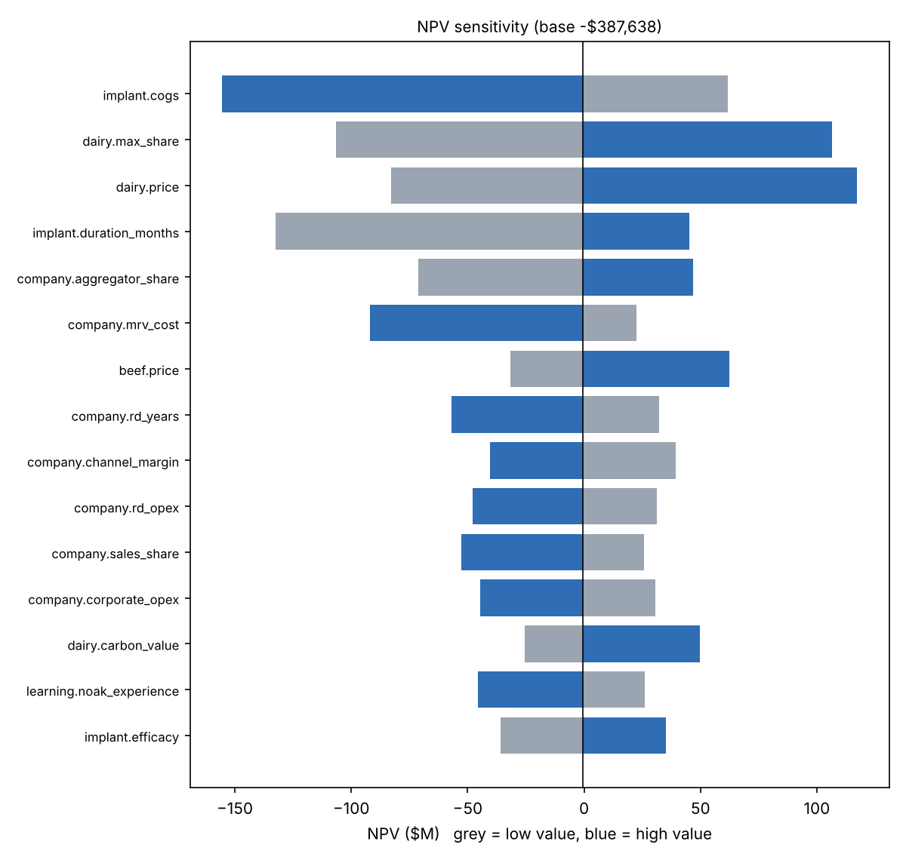
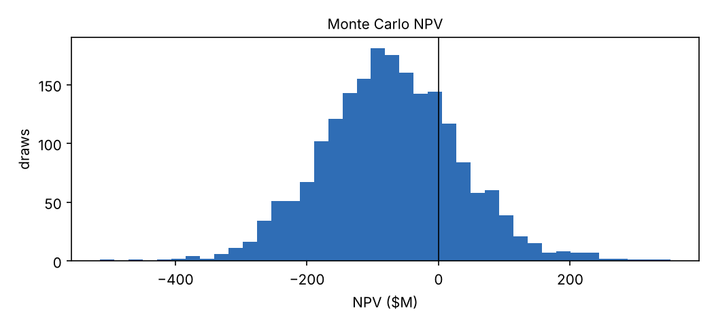

# Methane-reducing cattle implant: TEA results

## Conventions

- Real 2026 US dollars (pre-tax). Canadian and euro figures converted at the fx rates below.
- Unit costs are entered at NOAK (Nth of a kind). The cost of getting there is shown separately with Wright's-law learning curves.
- **Boundary:** Implant manufacture, distribution and data platform to the farmer's methane cut; excludes trial costs beyond R&D opex.
- **Functional units:** Farmer's cost per t CO2e avoided; dairy farmer's net gain per cow-year.
- Company discount rate 10%, customer discount rate 8%, horizon 15 years.

## Headline

| Metric | Value |
|---|---|
| NPV | -$387,638 |
| IRR | 10% |
| Probability NPV > 0 (Monte Carlo) | 23% |
| Peak cash need | $118.4M |
| Cash breakeven year | 12 |
| Revenue in final year | $200.6M |
| NOAK reached in year | 14 |
| Extra cost paid while learning (FOAK to NOAK) | $86.7M |
| NPV if costs started at NOAK (no learning period) | $40.3M |

## Customer cost vs BAU

**Farmer's cost per t CO2e avoided** ($/t CO2e)

| Option | Value | vs ours |
|---|---|---|
| Implant, dairy | $25 | 1.00x |
| Implant, grazing beef | $12 | 0.47x |
| Bovaer (dairy, fed daily) | $112 | 4.56x |
| Denmark livestock tax, effective 2035 (cost of doing nothing) | $43 | 1.75x |
| Dairy methane credit / insetting price | $30 | 1.22x |

Bovaer and other daily feed additives cannot reach animals on open range.

**Dairy farmer's net gain per cow-year (credits + data + productivity - cost)** ($/cow-yr)

| Option | Value | vs ours |
|---|---|---|
| Implant | $5 | 1.00x |
| Bovaer with credits | -$72 | -15.72x |
| Health bolus (smaXtec-type), data only | $131 | 28.41x |

Positive = farmer comes out ahead. The bolus row is a data-only benchmark with no methane benefit.

**Per-head economics by segment**

| Item | Dairy | Grazing beef |
|---|---|---|
| Enteric CH4 (kg/head-yr) | 117 | 72 |
| CO2e avoided (t/head-yr) | 0.63 | 0.39 |
| Credit value to farmer ($/head-yr) | $16.11 | $4.96 |
| Implant fee ($/head-yr) | $15.00 | $4.00 |
| Farmer net gain ($/head-yr) | $4.61 | $0.46 |
| Head treated in final year (M) | 7.5 | 10.0 |

## FOAK to NOAK

Cost multiplier vs the incumbent's cost for each component (1.00 = incumbent).

| Component | FOAK | NOAK |
|---|---|---|
| implant cost of goods | 2.94 | 1.00 |

## Cash flow

| Year | Phase | Revenue | Gross profit | Operating cost | EBIT | Capex | Cumulative cash | Cost vs incumbent |
|---|---|---|---|---|---|---|---|---|
| 1 | R&D | $0 | $0 | $20.0M | -$20.0M | $0 | -$20.0M | 2.94 |
| 2 | R&D | $0 | $0 | $20.0M | -$20.0M | $0 | -$40.0M | 2.94 |
| 3 | R&D | $0 | $0 | $20.0M | -$20.0M | $0 | -$60.0M | 2.94 |
| 4 | R&D | $0 | $0 | $20.0M | -$20.0M | $0 | -$80.0M | 2.94 |
| 5 | commercial | $25.1M | $390,427 | $17.5M | -$17.1M | $2.2M | -$99.3M | 2.94 |
| 6 | commercial | $50.1M | $8.4M | $20.0M | -$11.6M | $2.2M | -$113.1M | 2.24 |
| 7 | commercial | $75.2M | $19.4M | $22.5M | -$3.1M | $2.2M | -$118.4M | 1.83 |
| 8 | commercial | $100.3M | $31.3M | $25.0M | $6.3M | $2.2M | -$114.2M | 1.58 |
| 9 | commercial | $125.4M | $43.8M | $27.5M | $16.3M | $2.2M | -$100.1M | 1.41 |
| 10 | commercial | $150.4M | $56.6M | $30.0M | $26.6M | $2.2M | -$75.7M | 1.29 |
| 11 | commercial | $175.5M | $69.7M | $32.5M | $37.2M | $2.2M | -$40.8M | 1.19 |
| 12 | commercial | $200.6M | $83.0M | $35.1M | $48.0M | $2.2M | $5.0M | 1.12 |
| 13 | commercial | $200.6M | $85.8M | $35.1M | $50.7M | $0 | $55.8M | 1.05 |
| 14 | commercial | $200.6M | $87.9M | $35.1M | $52.8M | $0 | $108.6M | 1.01 |
| 15 | commercial | $200.6M | $88.2M | $35.1M | $53.1M | $0 | $161.7M | 1.00 |

Revenue in the final year by stream:

- implants: $152.5M (76%)
- data: $18.0M (9%)
- credit_share: $30.1M (15%)

## Break-evens

| Question | Answer | Base input |
|---|---|---|
| Methane cut for NPV = 0 | 0.201 | 0.2 |
| Dairy credit price ($/t) for NPV = 0 | 30.2 | 30 |
| NOAK cost per dose for NPV = 0 | 2.49 | 2.5 |
| Dairy implant fee for NPV = 0 | 15 | 15 |

## Scenarios

| Scenario | NPV | Final-year revenue | Peak cash need |
|---|---|---|---|
| Trial-level efficacy (13%) | -$25.2M | $190.0M | $126.1M |
| Bovaer-level efficacy (30%) | $35.0M | $215.6M | $108.2M |
| 6-month implant (two handlings a year) | -$132.4M | $200.6M | $227.7M |
| Dairy only | $23.5M | $151.8M | $96.8M |
| Beef only | -$176.3M | $48.7M | $356.8M |
| No data subscription | -$28.6M | $182.6M | $127.7M |
| Credits at $60/t (dairy) and $30/t (beef) | $70.4M | $230.6M | $102.9M |
| 1% productivity gain from saved feed energy | -$387,638 | $200.6M | $118.4M |

## Sensitivity (one input at a time)

| Input | Low | NPV at low | High | NPV at high |
|---|---|---|---|---|
| `implant.cogs` | 1.5 | $61.7M | 5.0 | -$155.5M |
| `dairy.max_share` | 0.1 | -$106.6M | 0.4 | $106.6M |
| `dairy.price` | 8 | -$82.8M | 25 | $117.3M |
| `implant.duration_months` | 6 | -$132.4M | 18 | $45.4M |
| `company.aggregator_share` | 0.0 | -$71.2M | 0.25 | $46.8M |
| `company.mrv_cost` | 0.5 | $22.5M | 3.0 | -$92.0M |
| `beef.price` | 2 | -$31.8M | 8 | $62.4M |
| `company.rd_years` | 3 | $32.3M | 6 | -$57.0M |
| `company.channel_margin` | 0.2 | $39.5M | 0.4 | -$40.3M |
| `company.rd_opex` | 10,000,000 | $31.3M | 35,000,000 | -$47.9M |
| `company.sales_share` | 0.05 | $25.9M | 0.2 | -$52.9M |
| `company.corporate_opex` | 8,000,000 | $30.7M | 25,000,000 | -$44.7M |
| `dairy.carbon_value` | 15 | -$25.5M | 60 | $49.8M |
| `learning.noak_experience` | 30,000,000 | $25.9M | 300,000,000 | -$45.5M |
| `implant.efficacy` | 0.1 | -$35.8M | 0.3 | $35.0M |

## Monte Carlo

2,000 draws, triangular distribution on every input with a range.

| P10 | P50 | P90 | P(NPV > 0) |
|---|---|---|---|
| -$201.8M | -$75.6M | $60.4M | 23% |

## Kill metrics

| Metric | Value | Threshold | Passes |
|---|---|---|---|
| Methane cut sustained over the implant's life | 0.20 fraction (>=0.15) | 0.15 | yes |
| Implant duration | 12.00 months (>=12) | 12.00 | yes |
| Farmer cost per t CO2e avoided, grazing beef | 11.57 $/t (<=50) | 50.00 | yes |
| Farmer net gain, dairy | 4.61 $/cow-yr (>=0) | 0.00 | yes |
| Farmer net gain, grazing beef | 0.46 $/head-yr (>=0) | 0.00 | yes |
| Serious adverse events per implanted head | 0.00 rate (<=0.001) | 0.00 | yes |
| Revenue at full scale vs big-enough line | 0.20 x | 1.00 | no |
| Probability NPV > 0 | 23% | 50% | no |

## Scorecard

Economics is scored from P(NPV > 0); the rest are judgment scores set in the inputs file.

| Category | Weight | Score |
|---|---|---|
| impact | 20% | 5 |
| breakthrough | 20% | 4 |
| feasibility | 15% | 3 |
| economics | 15% | 2 |
| scalability | 10% | 5 |
| demand | 10% | 2 |
| white space | 5% | 2 |
| validation | 5% | 3 |
| **Weighted total** | | **3.50** |

## Notes

- Impact check: 8.6 Mt CO2e/yr avoided in the final year, against ~3 Gt/yr from livestock.
- Passive RFID gives ID (and temperature, with a sensor tag) only within about a metre of a reader. Location tracking needs a battery-powered collar or bolus, so it is not in this product.
- Cost of goods learns with cumulative doses made (Wright's law); multipliers are relative to NOAK cost.
- CH4 converted at GWP100 = 27.

